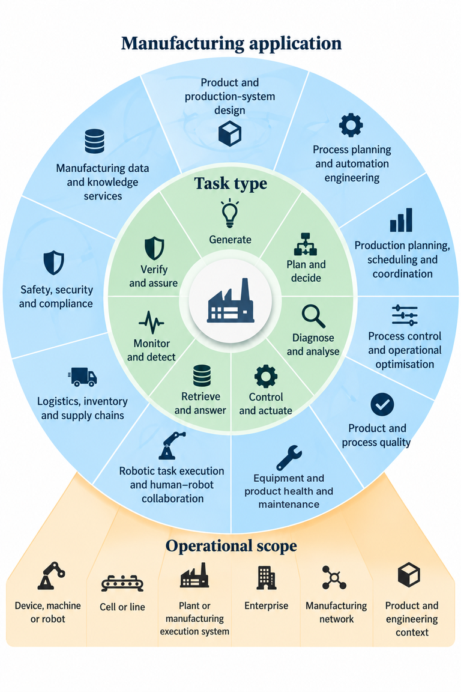
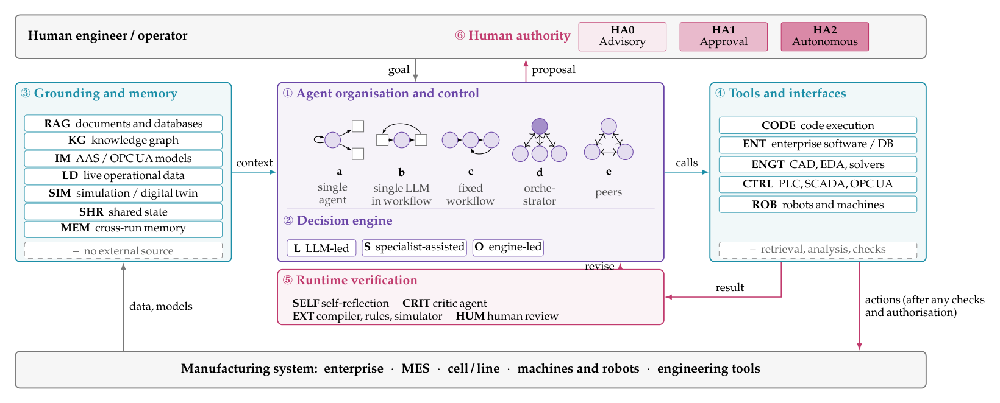
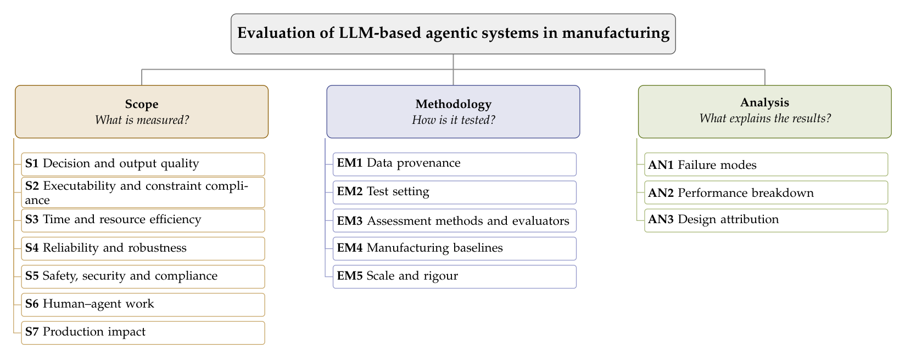
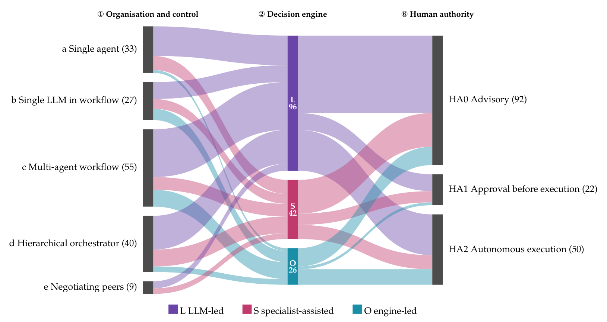

# Awesome Agentic Manufacturing

[](https://awesome.re) [](LICENSE)

A curated list of 164 peer-reviewed studies on LLM-based agentic AI in manufacturing, from the scoping review by Moradzadeh Farid and Shafiee (2026).

Each entry gives the reference as cited in the paper, followed by tags. **Tags:** task type · agent organisation·decision engine · human authority · test setting — defined in [codebook.md](codebook.md).

**Data:** [`screened_records.csv`](screened_records.csv) (all 815 screened records with decisions and reasons) · [`included_studies.csv`](included_studies.csv) (coding of the included studies).

## Taxonomy

Each study is coded along three connected taxonomies: what it does in manufacturing, how the agentic system is built, and how it is evaluated.

<p align="center"><br><em>Applications: manufacturing function, task type and operational scope</em></p>

<p align="center"><br><em>Agentic design: organisation, decision engine, grounding, tools, verification and human authority</em></p>

<p align="center"><br><em>Evaluation: scope, methodology and analysis</em></p>

<p align="center"><br><em>How the 164 systems are organised, who decides, and who authorises the action</em></p>

## Contents

- [Product and production-system design](#product-and-production-system-design)
- [Process planning and automation engineering](#process-planning-and-automation-engineering)
- [Production planning, scheduling and coordination](#production-planning-scheduling-and-coordination)
- [Process control and operational optimisation](#process-control-and-operational-optimisation)
- [Product and process quality](#product-and-process-quality)
- [Equipment and product health and maintenance](#equipment-and-product-health-and-maintenance)
- [Robotic task execution and human–robot collaboration](#robotic-task-execution-and-humanrobot-collaboration)
- [Logistics, inventory and supply chains](#logistics-inventory-and-supply-chains)
- [Safety, security and compliance](#safety-security-and-compliance)
- [Manufacturing data and knowledge services](#manufacturing-data-and-knowledge-services)

## Product and production-system design

- Lim, J.; Zhao, J.; Hernandez, E.; Kovalenko, I. [Adaptive task planning and coordination in multi-agent manufacturing systems using large language models](https://doi.org/10.1016/j.rcim.2026.103245). *Robotics and Computer-Integrated Manufacturing* **2026**, *100*, 103245. `OPT` `d·L` `HA2` `lab`
- Pflüger, J.; Ye, W.; Li, X.; Kim, S.G.; May, M.C. [Adversarial Agentic LLM based optimization for factory layout and dispatching selection](https://doi.org/10.1016/j.procir.2026.03.308). *Procedia CIRP* **2026**, *146*, 601–606. `OPT` `c·O` `HA0` `simulation`
- Pak, P.; Chandrasekhar, A.; Barati Farimani, A. [Agentic additive manufacturing alloy evaluation](https://doi.org/10.1016/j.addlet.2026.100355). *Additive Manufacturing Letters* **2026**, *17*, 100355. `OPT` `d·L` `HA0` `offline`
- Gyamenah, P.; Marinella, Z.; Schwartzberg, J.; Guo, S. [An agentic-AI method for 2D legacy to 3D CAD model reconstruction](https://doi.org/10.1016/j.mfglet.2026.08.093). *Manufacturing Letters* **2026**, *49*, 101–109. `GEN` `c·L` `HA0` `offline`
- Yang, H.; Ren, H. [Code, Not Canvas: Multi-Agent Layout Generation Beyond Vision Models](https://doi.org/10.1109/ASP-DAC66049.2026.11420765). In Proceedings of the Asia and South Pacific Design Automation Conference (ASP-DAC), 2026, pp. 632–638. `GEN` `d·L` `HA0` `offline`
- Lv, C.; Liu, S.; Tong, X.; Bao, J. [Cognitive 3D CAD model retrieval: a multi-agent system for intent-driven, cross-modal search](https://doi.org/10.1080/09544828.2026.2617799). *Journal of Engineering Design* **2026**, *37*, 3144–3174. `QA` `d·L` `HA0` `offline`
- Pradas-Gómez, A.; Brahma, A.; Isaksson, O. [DUCTILE: Agentic Large Language Model Orchestration of Engineering Analysis in Product Development Design Practice](https://doi.org/10.1115/1.4072279). *Journal of Mechanical Design* **2026**, *148*, 121706. `GEN` `a·L` `HA0` `industrial`
- Li, J.; Shi, D.; Zhang, Z.; Bauernhansl, T. [Data-driven meets knowledge-driven: an LLM‑agent framework for quality control in metal additive manufacturing](https://doi.org/10.1016/j.jii.2026.101182). *Journal of Industrial Information Integration* **2026**, *53*, 101182. `OPT` `a·S` `HA0` `offline`
- Gomes, G.; Ribeiro, E.; Pilarski, L.; Pinto, T.; Reis, A.; Barroso, J. [Digital Product Development with Multi-agent Systems: A Premium Pen Creation Case Study](https://doi.org/10.1007/978-3-032-05748-8_35). In Proceedings of the Distributed Computing and Artificial Intelligence, Special Sessions II, 22nd International Conference; Marreiros, G.; et al., Eds. Springer, 2026, Vol. 1630, *Lecture Notes in Networks and Systems*, pp. 415–426. `GEN` `c·L` `HA0` `no eval`
- Schwede, C.; Schipper, L.; Cirullies, J. [Enabling Non-Simulation Experts to Adapt Digital Twins during Production System Redesign using Agentic AI](https://doi.org/10.1145/3802463.3802479). In Proceedings of the 2026 9th International Conference on Computers in Management and Business (ICCMB), 2026, pp. 102–106. `GEN` `d·L` `HA0` `simulation`
- Tian, X.; Du, W.; Yang, S.; Hu, H.; Xin, H.; Qu, S.; Ye, K. [From Text to Simulation: A Multi-Agent LLM Workflow for Automated Chemical Process Design](https://doi.org/10.1609/aaai.v40i35.40215). *Proceedings of the AAAI Conference on Artificial Intelligence* **2026**, *40*, 29705–29713. `GEN` `c·L` `HA0` `simulation`
- Känsälä, L.; Daareyni, A.; Martikkala, A.; Rasku, J.; Ituarte, I.F. [GenAI-Driven Multiagent Systems for Design to Manufacturing Workflows](https://doi.org/10.1016/j.procir.2026.05.359). *Procedia CIRP* **2026**, *142*, 860–865. `GEN` `c·L` `HA0` `offline`
- Alesi, V.; Fall, A.; Grimalovsky, M.; Jackson, A.; Liu, D.; Burbano, D.; Haghani, S. [Impromptu: An LLM-Driven Prompt-to-Hardware Circuit Prototyping Platform on a Cartesian Gantry](https://doi.org/10.1109/ROSE69181.2026.11570982). In Proceedings of the 2026 IEEE International Symposium on Robotic and Sensors Environments (ROSE), 2026, pp. 1–7. `GEN` `b·L` `HA2` `lab`
- Liu, J.; Zhou, X.; Yu, S.; Duan, X.; Wang, J.; Wen, H.; Zhong, J.; Dou, Z. [LLM Agent-driven Automated DFA Assessment with Fine-tuning and AAS-based RAG](https://doi.org/10.1016/j.rcim.2026.103325). *Robotics and Computer-Integrated Manufacturing* **2026**, *102*, 103325. `VER` `a·L` `HA0` `offline`
- Wang, T.; Liu, Z.; Wang, X.V.; Wang, L. [LLM agents-driven layout generation for reconfigurable manufacturing systems](https://doi.org/10.1016/j.cirp.2026.03.015). *CIRP Annals* **2026**, *75*, 577–581. `GEN` `c·L` `HA0` `simulation`
- Liang, J.; Wu, D.; Wang, H.; Zhang, H.; Zhou, F.; Guo, M.; Zhang, S. [LLM-based rigid-flexible collaborative fixture optimization design of near-net-shaped jet engine blade machining](https://doi.org/10.1016/j.jmapro.2026.06.060). *Journal of Manufacturing Processes* **2026**, *173*, 391–411. `GEN` `b·O` `HA0` `simulation`
- Zhuang, W.; Pan, X.; Wen, S.; Yu, W.; Li, X.; Bao, J. [Large language model-enabled multi-agent self-organised approach for personalised rehabilitation assistive devices design](https://doi.org/10.1080/00207543.2025.2509155). *International Journal of Production Research* **2026**, *64*, 5209–5238. `GEN` `d·L` `HA1` `offline`
- Chung, H.; Lee, J.; Kwak, S.; Lee, M.; Lee, S. [Large language model-enhanced multi-agent framework for seamless design and manufacturing integration](https://doi.org/10.1016/j.jii.2026.101193). *Journal of Industrial Information Integration* **2026**, *54*, 101193. `GEN` `c·S` `HA0` `offline`
- Liu, Y.; Ren, D.; Ding, Y.; Zheng, J.; Deng, F. [Multi-Agent CAD Code Generation](https://doi.org/10.1145/3799902.3811067). In Proceedings of the SIGGRAPH 2026 Conference Papers, 2026, p. 20. `GEN` `c·L` `HA0` `offline`
- Liu, Y.; Ji, T.; Guo, X.; Ren, Y.; Xu, X.; Polzer, J. [Operationalising cognitive digital twins through a cognitive-function framework and GenAI tools](https://doi.org/10.1080/00207543.2026.2732141). *International Journal of Production Research* **2026**. `GEN` `b·L` `HA1` `simulation`
- Hetrich, M.; Sahu, C.K.; Narasimhan, S.; Chilukuri, P.K. [Power Circuit AI: Designing Power Electronic Circuits for Motor Drives with Generative Artificial Intelligence](https://doi.org/10.1109/IDCD69431.2026.11519438). In Proceedings of the 2026 IEEE International Conference on Intelligent Design and Control of Automation and Drive Systems (IDCD), 2026, pp. 1–7. `GEN` `c·L` `HA0` `offline`
- Hsu, Y.C.; Buehler, M.J. [SAGE-QA: Shared-context agentic graph-enhanced question answering for scientific reasoning](https://doi.org/10.1557/s43579-026-01036-4). *MRS Communications* **2026**. `QA` `d·L` `HA0` `offline`
- Sadruddin, S.; D’Souza, J.; Poupaki, E.; Watkins, A.; Karasulu, B.; Auer, S.; Mackus, A.; Kessels, E. [SCHEMA-MINER$^pro$: Agentic AI for Ontology Grounding over LLM-Discovered Scientific Schemas in a Human-in-the-Loop Workflow](https://doi.org/10.1177/22104968261431521). *Semantic Web* **2026**, *17*. `QA` `a·L` `HA1` `offline`
- Huang, X.; Song, Y.; Tang, H.; Pan, Y.; Gao, D.; Xu, K. [Seek-BCD: A Domain-Specialized Evolutionary Large Language Model Agent for BCD Technology](https://doi.org/10.1109/ISPSD64561.2026.11553990). In Proceedings of the 2026 IEEE 38th International Symposium on Power Semiconductor Devices and ICs (ISPSD), 2026, pp. 129–132. `OPT` `a·O` `HA0` `offline`
- Müller, E.; Knothe, T. [The Resource Friendly Experiment Agent](https://doi.org/10.1007/978-3-032-21154-5_36). In Proceedings of the Global Conference on Sustainable Manufacturing (GCSM 2025); Kohl, H.; et al., Eds. Springer, 2026, Lecture Notes in Mechanical Engineering, pp. 325–333. `OPT` `c·L` `HA0` `simulation`
- Rosendo, D.; DeWitt, S.; Souza, R.; Austria, P.; Ghosal, T.; McDonnell, M.; Miller, R.; Skluzacek, T.; Haley, J.; Turcksin, B.; et al. [AI Agents for Enabling Autonomous Experiments at ORNL's HPC and Manufacturing User Facilities](https://doi.org/10.1145/3731599.3767592). In Proceedings of the SC '25 Workshops of the International Conference for High Performance Computing, Networking, Storage and Analysis, New York, NY, USA, 2025; SC Workshops '25, pp. 2354–2361. `ACT` `d·O` `HA2` `simulation`
- Chen, X.; Gao, X.; Zhu, L.; Song, A.; Pan, Z. [ChatBuilder: LLM-assisted Modular Robot Creation](https://doi.org/10.1109/IROS60139.2025.11247761). In Proceedings of the IEEE International Conference on Intelligent Robots and Systems, 2025, pp. 16790–16797. `GEN` `c·L` `HA0` `simulation`
- Tang, J.; Xiao, H.; Li, X.; Wang, W.; Gong, Z. [ChatCAD: An MLLM-Guided Framework for Zero-shot CAD Drawing Restoration](https://doi.org/10.1109/ICASSP49660.2025.10890248). In Proceedings of the IEEE International Conference on Acoustics, Speech and Signal Processing (ICASSP), 2025, pp. 1–5. `GEN` `c·L` `HA0` `offline`
- Schüpbach, A.; San Miguel, R.; Ferchow, J.; Meboldt, M. [From text to design: a framework to leverage LLM agents for automated CAD generation](https://doi.org/10.1017/pds.2025.10203). *Proceedings of the Design Society* **2025**, *5*, 1893–1902. `GEN` `a·L` `HA0` `offline`
- Xu, W.; Zhang, M.; Jia, Y.; Lyu, R.; Song, Y. [GMFR-Coder: An LLM-Driven Approach to Code Generation for GNN-Based Machining Feature Recognition of Aircraft Structural Parts](https://doi.org/10.1109/ICEMCE68156.2025.11467062). In Proceedings of the 2025 9th International Conference on Electrical, Mechanical and Computer Engineering, ICEMCE 2025, 2025, pp. 431–437. `GEN` `c·L` `HA0` `offline`
- Chen, G.; Yang, H.; Yu, B.; Ren, H. [Intelligent OPC Engineer Assistant for Semiconductor Manufacturing](https://doi.org/10.1609/aaai.v39i22.34479). *Proceedings of the AAAI Conference on Artificial Intelligence* **2025**, *39*, 23144–23151. `GEN` `c·O` `HA0` `simulation`
- Li, Z.; Liu, Z.; Sa, G.; Sun, J.; Hou, M.; Tan, J.; Sun, L.; Wei, J. [Knowledge-enhanced large language models for ideation to implementation: A new paradigm in product design](https://doi.org/10.1016/j.asoc.2025.113147). *Applied Soft Computing* **2025**, *176*, 113147. `GEN` `a·L` `HA0` `offline`
- Hizmi, B.E.; Sterman, Y.; Austern, G. [LLMto3D - Generation of parametric, 3D printable objects using large language models](https://doi.org/10.1177/14780771251353792). *International Journal of Architectural Computing* **2025**, *23*, 701–719. `GEN` `c·L` `HA0` `offline`
- Qin, H.; Kou, J.; Zhang, L.; Kang, W.; Xing, W.W. [Multi-Agent Yield Analysis for Circuit Design](https://doi.org/10.1109/DAC63849.2025.11133334). In Proceedings of the Design Automation Conference (DAC), 2025, pp. 1–7. `OPT` `d·O` `HA0` `simulation`
- Xia, X.; Zhang, D.; Liao, Z.; Hou, Z.; Sun, T.; Li, J.; Fu, L.; Dong, Y. [SceneGenAgent: Precise Industrial Scene Generation with Coding Agent](https://doi.org/10.18653/v1/2025.acl-long.873). In Proceedings of the Annual Meeting of the Association for Computational Linguistics (ACL), 2025, Vol. 1, pp. 17847–17875. `GEN` `b·L` `HA0` `simulation`
- Santos, G.R.; Fleury, A.L.; Leite, R.; Paz, J.C.; Muneratti Ortega, F.J.; Mamillapalli, L.S.; Luduvico, D.; Soares, M.; Murakami, M.; Zancul, E. [Smart product configurator applying large language models: the case of construction equipment machines](https://doi.org/10.1016/j.procir.2025.08.103). *Procedia CIRP* **2025**, *136*, 600–605. `OPT` `d·L` `HA0` `offline`
- Zheng, K.; Zhong, Y.; Su, X.; Leng, J.; Liu, Q.; Chen, X. [Towards agentic smart design: An industrial large model-driven human-in-the-loop agentic workflow for geometric modelling](https://doi.org/10.1016/j.asoc.2025.113920). *Applied Soft Computing* **2025**, *185*, 113920. `GEN` `c·L` `HA0` `offline`
- Zhou, L.; Zhang, L.; Chen, X.; Ding, Y.; Wang, Y. [The Heuristic Design Innovation Approach for Data-Integrated Large Language Model](https://doi.org/10.1007/978-3-031-60615-1_12). In Proceedings of the Artificial Intelligence in HCI. Springer, 2024, Vol. 14736, *Lecture Notes in Computer Science*, pp. 170–195. `GEN` `a·L` `HA0` `sandbox`

## Process planning and automation engineering

- Yin, B.; Sun, N. [Closed-Loop Recovery Mechanism for Multi-agent Process Planning Under Manufacturing Constraints](https://doi.org/10.1007/978-981-92-3403-5_13). In Proceedings of the International Conference on Intelligent Computing (ICIC 2026); Huang, D.S.; et al., Eds. Springer, 2027, Vol. 16649, *Lecture Notes in Computer Science*, pp. 169–181. `GEN` `c·L` `HA0` `offline`
- Li, J.; Li, S.; Martin, C.; Chen, Z.; Chen, D.; Li, W. [An LLM-assisted multi-agent control framework for roll-to-roll manufacturing systems](https://doi.org/10.1016/j.jmsy.2026.04.005). *Journal of Manufacturing Systems* **2026**, *86*, 569–578. `ACT` `c·O` `HA2` `simulation`
- Song, Z.; Tan, Y.; Chen, J.; Arista, R.; Zheng, X. [Design-on-Graph: A Graph Retrieval-Augmented Generation-Based Method to Support Manufacturing System Design](https://doi.org/10.1007/978-3-032-03550-9_27). In Proceedings of the Advances in Production Management Systems (APMS 2025); Mizuyama, H.; et al., Eds. Springer, 2026, Vol. 769, *IFIP Advances in Information and Communication Technology*, pp. 401–415. `GEN` `d·L` `HA0` `offline`
- Park, H.; Kim, S. [Development of an LLM-Based Multi-Agent System for Sewing Sequence Planning](https://doi.org/10.1177/0887302X261487373). *Clothing and Textiles Research Journal* **2026**. `GEN` `c·L` `HA0` `offline`
- Wei, H.; Zhang, Z. [Event-Structured LLM Planning for Continuous-Parameter Industrial Workflows](https://doi.org/10.1109/ICMTIM69588.2026.11525771). In Proceedings of the 2026 7th International Conference on Mechatronics Technology and Intelligent Manufacturing, ICMTIM 2026, 2026, pp. 45–53. `GEN` `b·L` `HA2` `offline`
- Chen, H.; Liu, S.; Xia, L.; Li, Z.; Law, W.C.; Navarro-Alarcon, D.; Zheng, P. [GLaMP: A Grounded Language Model-Based Multiagent System for Long-Horizon Robotic Task Planning in Industrial Settings](https://doi.org/10.1109/TIE.2026.3713552). *IEEE Transactions on Industrial Electronics* **2026**, pp. 1–13. `ACT` `c·S` `HA2` `lab`
- Xu, Q.; Zhang, Y.; Tang, H.; Ran, Q.; Gao, H.; Xu, Y. [H2A-BPMN: A Hierarchical and Hybrid Agent Framework for Industrial BPMN Automated Modeling](https://doi.org/10.1007/978-3-032-21171-2_10). In Proceedings of the Collaborative Computing: Networking, Applications and Worksharing (CollaborateCom 2025); Gao, H.; Wang, X., Eds. Springer, 2026, Vol. 681, *Lecture Notes of the Institute for Computer Sciences, Social Informatics and Telecommunications Engineering*, pp. 180–205. `GEN` `c·L` `HA0` `offline`
- Engert, G.E.; Bischoff, A.K.; Weigold, M. [Human-Centered Development of a Multi-Agent AI System Based on Large Language Models for CNC Machine Tool Operation in Production](https://doi.org/10.1016/j.procir.2026.03.275). *Procedia CIRP* **2026**, *146*, 1–6. `QA` `d·L` `HA0` `lab`
- Gao, Q.; Gu, F.; Ji, Y. [IMAT-Print: Intention-Oriented Augmented Memory for Agentic Tiny-LLM in Electronic Additive Manufacturing](https://doi.org/10.1109/AIoTC71250.2026.11688658). In Proceedings of the 2026 5th International Conference on Artificial Intelligence, Internet of Things and Cloud Computing Technology (AIoTC). IEEE, 2026, pp. 48–54. `GEN` `b·L` `HA1` `offline`
- Mousavi, S.M.; Majidi, B.; Shalmani, M.T.M. [TreeEvolve: LLM-Driven End-to-End Pipeline for IIoT-Enabled Process Optimization in Food Industry](https://doi.org/10.1109/ICWR69602.2026.11513348). In Proceedings of the 2026 International Conference on Web Research (ICWR), 2026, pp. 372–376. `GEN` `c·O` `HA0` `simulation`
- Fan, H.; Huang, J.; Xu, J.; Zhou, Y.; Fuh, J.Y.H.; Lu, W.F.; Li, B. [AutoMEX: Streamlining material extrusion with AI agents powered by large language models and knowledge graphs](https://doi.org/10.1016/j.matdes.2025.113644). *Materials and Design* **2025**, *251*, 113644. `ACT` `a·L` `HA2` `lab`
- Chen, K.; Wang, T.; Ni, M.; Cheng, L.; Wang, Z.; Chen, C. [Collaborative LLM agents for flexible software development of intelligent industrial robot control systems](https://doi.org/10.1007/s40747-025-02051-z). *Complex and Intelligent Systems* **2025**, *11*, 476. `GEN` `c·L` `HA1` `simulation`
- Fan, H.; Liu, X.; Fuh, J.Y.H.; Lu, W.F.; Li, B. [Embodied intelligence in manufacturing: leveraging large language models for autonomous industrial robotics](https://doi.org/10.1007/s10845-023-02294-y). *Journal of Intelligent Manufacturing* **2025**, *36*, 1141–1157. `ACT` `b·L` `HA2` `simulation`
- Xie, Y.; Liu, J.; Wang, R.; Wang, Z.; Yu, K.; Song, Z. [Rapid generation method of process routes based on multi-agent collaboration with LLMs](https://doi.org/10.1016/j.aei.2025.103733). *Advanced Engineering Informatics* **2025**, *68*, 103733. `GEN` `c·S` `HA0` `offline`
- Xavier, M.; Patil, S.; Yang, C.W.; Vyatkin, V. [ReACT - Gen AI Agents for Reasoning, Planning, and Testing in IEC 61499-Based Control Systems](https://doi.org/10.1109/IECON58223.2025.11221719). In Proceedings of the Annual Conference of the IEEE Industrial Electronics Society (IECON), 2025, pp. 1–6. `ACT` `d·L` `HA1` `lab`
- Gerdes, H.; Reisch, R.T.; Burschka, D. [Shopfloor-Integrated Manufacturing Operation Planning through Agents](https://doi.org/10.1109/ETFA65518.2025.11205809). In Proceedings of the IEEE International Conference on Emerging Technologies and Factory Automation, ETFA, 2025, pp. 1–8. `ACT` `a·O` `HA1` `lab`
- Holland, M.; Chaudhari, K. [Large language model based agent for process planning of fiber composite structures](https://doi.org/10.1016/j.mfglet.2024.03.010). *Manufacturing Letters* **2024**, *40*, 100–103. `GEN` `a·L` `HA0` `offline`

## Production planning, scheduling and coordination

- da Silva, G.R.B.; de M. B. Filho, I.; Gurgel, A.M.; de Macedo, L.V.; Ferraz, S.R.B.; de Moura, B.S.; Malaquias, R.S.; Lima, J.M.M. [Implementation of an Orchestrated Multi-agent System for PPCP in Textile MSMEs: A Prompt Engineering Approach](https://doi.org/10.1007/978-3-032-30488-9_10). In Proceedings of the International Conference on Computational Science and Its Applications (ICCSA 2026); Gervasi, O.; et al., Eds. Springer, 2027, Vol. 16768, *Lecture Notes in Computer Science*, pp. 157–172. `OPT` `d·L` `HA0` `simulation`
- Zhao, Z.; Tang, D.; Liu, C.; Wang, L.; Zhang, Z.; Zhu, H.; Chen, K.; Nie, Q.; Ji, Y. [A Large language model-based multi-agent manufacturing system for intelligent shopfloors](https://doi.org/10.1016/j.aei.2025.103888). *Advanced Engineering Informatics* **2026**, *69*, 103888. `OPT` `e·L` `HA2` `lab`
- Liu, Y.; Yang, M.; Jiang, P. [A memory-augmented LLM-driven method for autonomous merging of 3D printing work orders](https://doi.org/10.1016/j.procir.2025.08.194). *Procedia CIRP* **2026**, *139*, 458–464. `OPT` `a·L` `HA2` `simulation`
- Li, M.; Zhou, Q.; Li, W.; Qu, T.; Yang, M.; Jiang, P. [A4PS: Agentic AI-assisted advanced planning and scheduling with large language models for smart manufacturing](https://doi.org/10.1016/j.jmsy.2026.01.003). *Journal of Manufacturing Systems* **2026**, *85*, 207–226. `GEN` `c·L` `HA1` `offline`
- Graul, C.; Żarski, W.; Mikołajewski, D.; Rojek, I. [AI Agents in Industry 4.0: AAS–OPC UA–LLM Architecture as the Foundation of Intelligent Manufacturing Systems in the Context of Industrial Enterprise Implementation](https://doi.org/10.3390/app16115428). *Applied Sciences* **2026**, *16*, 5428. `ACT` `a·L` `HA1` `simulation`
- May, M.C.; Liang, P.; Kim, S.G. [Agentic LLM-based Contingency Management in Production Control](https://doi.org/10.1016/j.procir.2025.08.195). *Procedia CIRP* **2026**, *139*, 373–378. `OPT` `c·L` `HA2` `simulation`
- Oberle, M.; Schel, D.; Bauernhansl, T. [Agentic Manufacturing Operations Management: Concept and First Prototype](https://doi.org/10.1016/j.procir.2026.05.280). *Procedia CIRP* **2026**, *142*, 392–397. `ACT` `c·L` `HA1` `lab`
- Li, J.; Ruan, Q.; Shi, D.; Schneider, M.; Meyer, O.; Oberle, M.; Yi, L.; Tao, F. [Agentic active Asset Administration Shell for circular manufacturing](https://doi.org/10.1016/j.jmsy.2026.07.011). *Journal of Manufacturing Systems* **2026**, *88*, 858–886. `ACT` `d·L` `HA2` `sandbox`
- Sun, J.; Cai, C.; Chen, Y.; Wang, J. [An LLM-Driven Multi-Agent Evolution Framework for Solver Code Generation in Job Shop Scheduling](https://doi.org/10.3390/math14112010). *Mathematics* **2026**, *14*, 2010. `GEN` `c·O` `HA0` `offline`
- Yang, S.; Wang, A.; Xu, Z.; Yang, K.; Lou, R. [An industrial intelligent scheduling method and system based on agent clusters](https://doi.org/10.1117/12.3110757). *Proceedings of SPIE - The International Society for Optical Engineering* **2026**, *14186*, 1418636. `DIA` `a·S` `HA0` `sandbox`
- Zhang, Y.; Imani, F.; Tang, J. [ConDA: A constraint discovery agent for cross-system optimization of manufacturing operations](https://doi.org/10.1016/j.jmsy.2026.09.001). *Journal of Manufacturing Systems* **2026**, *89*, 280–297. `OPT` `d·O` `HA2` `simulation`
- Ye, W.; Li, X. [Coordination of LLM-Embodied Agents for manufacturing task allocation under constraints](https://doi.org/10.1016/j.jmsy.2026.04.028). *Journal of Manufacturing Systems* **2026**, *87*, 17–26. `OPT` `e·L` `HA2` `simulation`
- Murdivien, S.A.; Park, J.; Um, J. [Dynamic reconfiguration in multi-robot agent systems using embedded language models](https://doi.org/10.1016/j.rcim.2026.103308). *Robotics and Computer-Integrated Manufacturing* **2026**, *101*, 103308. `OPT` `d·S` `HA2` `lab`
- Xiang, W.; Zhang, J.; Zhang, P.; Wang, M. [Dynamic scheduling of wafer batch processing machines via reinforcement learning enhanced by expert-guided lightweight LLM](https://doi.org/10.1080/00207543.2025.2582768). *International Journal of Production Research* **2026**, *64*, 2731–2752. `OPT` `c·O` `HA2` `simulation`
- Zhang, W.; Zuo, C.; Kong, M.; Zhang, T.; Fathollahi-Fard, A.M.; Dulebenets, M.A. [Human-Robot Collaborative Supply Chain Scheduling via Reinforcement Learning, Large Neighborhood Search, and Large Language Models](https://doi.org/10.1016/j.jii.2026.101152). *Journal of Industrial Information Integration* **2026**, *52*, 101152. `OPT` `c·O` `HA0` `offline`
- Yan, J.; Ji, S. [Industrial mechanism-aware multi-agent collaboration of large language models for job shop scheduling optimization](https://doi.org/10.1016/j.cie.2026.112079). *Computers and Industrial Engineering* **2026**, *217*, 112079. `GEN` `c·O` `HA0` `offline`
- Abbes, W.; Nakkach, C.; Picaud, Y. [Intelligent Production Scheduling under Constraints Using LLMs for Industry 5.0](https://doi.org/10.5220/0014636600004055). In Proceedings of the International Conference on Operations Research and Enterprise Systems, 2026, Vol. 1, pp. 588–595. `OPT` `b·L` `HA0` `offline`
- Zuo, T.Y.; Li, P.; Di, K.; Lin, J.; Jiang, Y. [KA-Graph: Knowledge-Aware Orchestration for Industrial Agent Services Under Knowledge Asymmetry](https://doi.org/10.1109/TSC.2026.3734284). *IEEE Transactions on Services Computing* **2026**. `QA` `c·L` `HA0` `offline`
- Ma, F.; Dang, Y.; Ma, H. [LLM-Driven Multi-Agent Reinforcement Learning for Resilient AGV Dispatching Under Dynamic Disruptions in Smart Manufacturing](https://doi.org/10.1109/AIITA69518.2026.11567113). In Proceedings of the 2026 6th International Conference on Artificial Intelligence and Industrial Technology Applications, AIITA 2026, 2026, pp. 1625–1628. `OPT` `b·O` `HA2` `simulation`
- Liu, C.; Tang, D.; Zhu, H.; Wang, L.; Cai, Q.; Nie, Q. [LLM-enhanced embodied multi-agent manufacturing system: A novel self-organizing production paradigm for embodied perception, embodied analysis and embodied decision](https://doi.org/10.1016/j.jmsy.2025.12.016). *Journal of Manufacturing Systems* **2026**, *84*, 357–382. `OPT` `e·S` `HA1` `lab`
- Lim, J.; Anbarani, M.T.; Meira-Goes, R.; Kovalenko, I. [Logic-Based Verification of Task Allocation for LLM-Enabled Multi-Agent Manufacturing Systems](https://doi.org/10.1109/WODES69290.2026.11598152). In Proceedings of the 2026 18th International Workshop on Discrete Event Systems, WODES 2026, 2026, pp. 139–144. `VER` `c·L` `HA1` `offline`
- Park, J.; Kim, K.S.; Faturrahman, Z.; Kim, H.J. [MARS: Multi-Agent Rescheduling Framework with Large Language Models for Human-Centric Manufacturing](https://doi.org/10.1016/j.jmsy.2026.07.015). *Journal of Manufacturing Systems* **2026**, *88*, 903–928. `OPT` `c·O` `HA1` `offline`
- Gao, Q.; GU, F.; Guo, J.; Ji, Y. [Multitask fine-tuning agentic AI based collaborative scheduling for flexible manufacturing systems](https://doi.org/10.1016/j.jmsy.2026.04.022). *Journal of Manufacturing Systems* **2026**, *86*, 864–886. `OPT` `d·O` `HA2` `simulation`
- Gao, D.; Wen, X.; Lv, J.; Si, J.; Wang, C.; Bao, J. [Self-evolving digital twins in flexible manufacturing: A large language model-powered multi-agent approach](https://doi.org/10.1016/j.dte.2026.100099). *Digital Engineering* **2026**, *10*, 100099. `MON` `d·L` `HA2` `simulation`
- Lim, J.; Kovalenko, I. [A Large Language Model-Enabled Control Architecture for Dynamic Resource Capability Exploration in Multi-Agent Manufacturing Systems](https://doi.org/10.1109/CASE58245.2025.11163802). In Proceedings of the IEEE International Conference on Automation Science and Engineering, 2025, pp. 2088–2095. `OPT` `b·L` `HA2` `simulation`
- Liu, C.; Nie, Q. [A blockchain-based LLM-driven energy-efficient scheduling system towards distributed multi-agent manufacturing scenario of new energy vehicles within the circular economy](https://doi.org/10.1016/j.cie.2025.110889). *Computers and Industrial Engineering* **2025**, *201*, 110889. `OPT` `b·L` `HA2` `simulation`
- Kan, X.; Dai, Y.; Shi, J. [ABCM: Agent-Based Complexity Management Method for Intelligent Manufacturing](https://doi.org/10.1145/3760269.3760353). In Proceedings of the 2025 5th International Conference on Automation Control, Algorithm and Intelligent Bionics (ACAIB), 2025, pp. 540–546. `DIA` `a·L` `HA0` `no eval`
- Zhang, Z.; Ji, Z.; Wang, H.; Wang, J. [Applying Large Language Models as Hybrid-Algorithm Experts for Job Shop Scheduling Problems](https://doi.org/10.1109/SMC58881.2025.11342734). In Proceedings of the IEEE International Conference on Systems, Man, and Cybernetics (SMC), 2025, pp. 7263–7268. `GEN` `c·O` `HA0` `offline`
- Vieira Da Silva, L.M.; Kocher, A.; Gehlhoff, F. [Beyond Formal Semantics for Capabilities and Skills: Model Context Protocol in Manufacturing](https://doi.org/10.1109/ETFA65518.2025.11205601). In Proceedings of the IEEE International Conference on Emerging Technologies and Factory Automation, ETFA, 2025, pp. 1–4. `ACT` `a·L` `HA2` `lab`
- Yuan, Z.; Li, M.; Liu, C.; Han, F.; Huang, H.; Dai, H.N. [Chat with MES: LLM-driven user interface for manipulating garment manufacturing system through natural language](https://doi.org/10.1016/j.jmsy.2025.02.008). *Journal of Manufacturing Systems* **2025**, *80*, 1093–1107. `ACT` `b·L` `HA2` `simulation`
- Barbosa, R.; Santos, R.; Novais, P. [Collaborative Problem-Solving with LLM: A Multi-agent System Approach to Solve Complex Tasks Using Autogen](https://doi.org/10.1007/978-3-031-73058-0_17). In Proceedings of the Highlights in Practical Applications of Agents, Multi-Agent Systems, and Digital Twins: The PAAMS Collection. Springer, 2025, Vol. 2149, *Communications in Computer and Information Science*, pp. 203–214. `OPT` `e·L` `HA2` `sandbox`
- Manssouri, M.; Bouguelia, S.; Bentaha, M.L. [Comparison of E2E and Pipeline Conversational Architectures for Production Line Rebalancing](https://doi.org/10.1109/ICTAI66417.2025.00172). In Proceedings of the IEEE International Conference on Tools with Artificial Intelligence (ICTAI), 2025, pp. 1181–1186. `OPT` `b·O` `HA0` `offline`
- Xia, Y.; Jazdi, N.; Zhang, J.; Shah, C.; Weyrich, M. [Control Industrial Automation System with Large Language Model Agents](https://doi.org/10.1109/ETFA65518.2025.11205539). In Proceedings of the IEEE International Conference on Emerging Technologies and Factory Automation, ETFA, 2025, pp. 1–8. `ACT` `d·L` `HA2` `offline`
- Murdivien, S.A.; Um, J. [Human-Understandable Communication for Industrial Multi-Robot Systems Using LLMs](https://doi.org/10.1016/j.ifacol.2025.09.490). *IFAC-PapersOnLine* **2025**, *59*, 2916–2920. `ACT` `d·S` `HA2` `lab`
- Wang, Z.; Wan, C.; Liu, J.; Zhang, X.; Wang, H.; Hu, Y.; Hu, Z. [MASC: Large language model-based multi-agent scheduling chain for flexible job shop scheduling problem](https://doi.org/10.1016/j.aei.2025.103527). *Advanced Engineering Informatics* **2025**, *67*, 103527. `OPT` `c·O` `HA2` `offline`
- Li, X.; Zhou, X.; Li, J.; Di, Q.; Jing, L.; Fan, B. [Retrieval-Augmented LLM-Driven Multi-Agent Optimization Framework for Intelligent Manufacturing Scheduling](https://doi.org/10.1109/HPCC67675.2025.00214). In Proceedings of the 2025 IEEE International Conferences on High Performance Computing and Communications, Data Science and Systems, Smart City, Dependability in Sensor, Cloud, and Big Data Systems and Applications, and Embedded Software and Systems (HPCC/DSS/SmartCity/DependSys/ICESS), 2025, pp. 1471–1476. `OPT` `c·O` `HA0` `offline`
- Lim, J.; Vogel-Heuser, B.; Kovalenko, I. [Large Language Model-Enabled Multi-Agent Manufacturing Systems](https://doi.org/10.1109/CASE59546.2024.10711432). In Proceedings of the IEEE International Conference on Automation Science and Engineering, 2024, pp. 3940–3946. `ACT` `d·L` `HA2` `simulation`

## Process control and operational optimisation

- Xue, Z.; He, X. [A Multi-Agent Framework for Step-Level Tool-Call Safety Evaluation in Industrial Control Systems](https://doi.org/10.1109/AIITA69518.2026.11567230). In Proceedings of the 2026 6th International Conference on Artificial Intelligence and Industrial Technology Applications, AIITA 2026, 2026, pp. 1180–1189. `VER` `a·L` `HA2` `offline`
- Song, Y.T.; Sun, Y.N.; Jiang, J.; Liu, L.L.; Gao, Z.G.; Qin, W. [An autonomous AI Agent framework for dynamic assembly quality control via LLM-based heuristic evolution](https://doi.org/10.1016/j.aei.2026.105060). *Advanced Engineering Informatics* **2026**, *76*, 105060. `OPT` `b·O` `HA0` `offline`
- Papacharalampopoulos, A.; Karagianni, O.M.; Stavropoulos, P. [Cognitive Supervisory Control with LLM Reasoning Agent for Fault-Tolerant Process Systems: A Digital Twin Perspective](https://doi.org/10.3390/pr14142298). *Processes* **2026**, *14*, 2298. `ACT` `b·O` `HA2` `simulation`
- Lin, Y.; Yu, S.; Yao, J.; Guo, J.; Kumar, M.; Zhang, H.; Peng, S. [EcoLLM: A lightweight ReAct-SFT framework for document-driven LCI extraction and automated LCIA in metal additive manufacturing](https://doi.org/10.1016/j.jclepro.2026.148797). *Journal of Cleaner Production* **2026**, *571*, 148797. `DIA` `a·L` `HA0` `offline`
- Vyas, J.; Mercangöz, M. [Autonomous Industrial Control using an Agentic Framework with Large Language Models](https://doi.org/10.1016/j.ifacol.2025.07.170). *IFAC-PapersOnLine* **2025**, *59*, 349–354. `ACT` `c·L` `HA2` `lab`
- Provatidis, I.; Cobilean, V.; Sandström, K.; Behnam, M. [Generative AI Multi-Agent System with Retrieval Augmented Generation for Real-Time Furnace Operation Support in Industrial Manufacturing](https://doi.org/10.1109/IECON58223.2025.11221518). In Proceedings of the Annual Conference of the IEEE Industrial Electronics Society (IECON), 2025, pp. 1–6. `MON` `d·S` `HA0` `offline`
- Gautam, A.; Aryal, M.R.; Deshpande, S.; Padalkar, S.; Nikolaenko, M.; Tang, M.; Anand, S. [IIoT-enabled digital twin for legacy and smart factory machines with LLM integration](https://doi.org/10.1016/j.jmsy.2025.03.022). *Journal of Manufacturing Systems* **2025**, *80*, 511–523. `QA` `d·S` `HA1` `lab`
- Lee, J.; Kim, J.Y.; Kim, H.; Lee, I.; Ryu, S. [IM-Chat: A multi-agent LLM framework integrating tool-calling and diffusion modeling for knowledge transfer in injection molding industry](https://doi.org/10.1016/j.jmsy.2025.11.007). *Journal of Manufacturing Systems* **2025**, *83*, 839–855. `QA` `d·S` `HA0` `offline`
- Geng, C.; Wang, D.; Liu, Y.; Shi, X. [Knowledge-Driven Multi-Agent AI for Interpretable Yield Optimization in Semiconductor Manufacturing](https://doi.org/10.1109/AIHCIR67580.2025.11404861). In Proceedings of the 2025 4th International Conference on Artificial Intelligence, Human-Computer Interaction and Robotics, AIHCIR 2025, 2025. `DIA` `c·S` `HA0` `offline`
- Jadhav, Y.; Pak, P.; Barati Farimani, A. [LLM-3D print: Large Language Models to monitor and control 3D printing](https://doi.org/10.1016/j.addma.2025.105027). *Additive Manufacturing* **2025**, *114*, 105027. `ACT` `d·L` `HA2` `lab`
- Gill, M.S.; Vyas, J.; Markaj, A.; Gehlhoff, F.; Mercangöz, M. [Leveraging LLM Agents and Digital Twins for Fault Handling in Process Plants](https://doi.org/10.1109/ETFA65518.2025.11205597). In Proceedings of the 2025 IEEE 30th International Conference on Emerging Technologies and Factory Automation (ETFA). IEEE, 2025, pp. 1–8. `ACT` `c·L` `HA2` `simulation`
- Chen, T.L.; Tsai, Y.T.; Yang, W.Y.; Zheng, Z.W. [Voltage Anomaly Detection and Forecasting of Electrical Energy Consumption for Machine Tools using an AI-based Agent Framework](https://doi.org/10.1109/AIoT66900.2025.00107). In Proceedings of the 2025 IEEE Annual Congress on Artificial Intelligence of Things (AIoT), 2025, pp. 695–699. `DIA` `d·S` `HA0` `offline`
- Xia, Y.; Dittler, D.; Jazdi, N.; Chen, H.; Weyrich, M. [LLM experiments with simulation: Large Language Model Multi-Agent System for Simulation Model Parametrization in Digital Twins](https://doi.org/10.1109/ETFA61755.2024.10710900). In Proceedings of the 2024 IEEE 29th International Conference on Emerging Technologies and Factory Automation (ETFA). IEEE, 2024, pp. 1–4. `OPT` `c·L` `HA0` `simulation`

## Product and process quality

- Takahashi, J.; Moteki, A.; Uchida, A.; Masui, S.; Yang, F.; Uchino, K.; Song, Y.; Bisk, Y.; Neubig, G.; Kusajima, I.; et al. [FieldWorkArena: Agentic AI Benchmark for Real Field Work Tasks](https://doi.org/10.1007/978-3-032-31663-9_7). *Lecture Notes in Computer Science* **2027**, *16815*, 94–108. `MON` `a·L` `HA0` `sandbox`
- Li, L.; Zhang, Y.; Makanda, I.L.D.; Jiang, P. [3DprintMIND: An AI-Agent system using large language models and dynamic manufacturing knowledge graphs for smart manufacturing](https://doi.org/10.1016/j.rcim.2025.103214). *Robotics and Computer-Integrated Manufacturing* **2026**, *99*, 103214. `DIA` `a·S` `HA1` `lab`
- Zheng, H.; Huang, J.; Xue, J.; Li, X.; Xu, X. [A compositional dual-hand action recognition method for LLM-driven assembly assistance](https://doi.org/10.1016/j.jmsy.2026.07.017). *Journal of Manufacturing Systems* **2026**, *88*, 929–950. `MON` `a·S` `HA0` `offline`
- Bayram, M.T.; Razouk, H.; Kyamakya, K. [Action-Oriented Programming and Automatic Agent Generation for Adaptive Data Collection in Decentralized Data Ecosystems](https://doi.org/10.3390/pr14101669). *Processes* **2026**, *14*, 1669. `DIA` `d·L` `HA0` `sandbox`
- Dang, J.; Vedova, J.D.; Yang, Y. [The 1% problem: LLM orchestration for rare event detection in manufacturing supply chains](https://doi.org/10.1016/j.ijpe.2026.110119). *International Journal of Production Economics* **2026**, *300*, 110119. `DIA` `b·S` `HA0` `offline`
- Jee, T. [LLM-Based Overlay Issue Classification and Solution Optimization in Semiconductor Manufacturing](https://doi.org/10.1117/12.3050976). *Proceedings of SPIE - The International Society for Optical Engineering* **2025**, *13425*, 134251D. `DIA` `a·S` `HA0` `simulation`
- Upadhyaya, B. [Near-Closed-Loop-Control in PV Manufacturing with Centralized Reasoning Agent: LLM and Semantic Kernel based Implementation](https://doi.org/10.1109/NAPS66256.2025.11272240). In Proceedings of the 2025 57th North American Power Symposium, NAPS 2025, 2025, pp. 1–6. `DIA` `d·L` `HA0` `offline`

## Equipment and product health and maintenance

- Lin, J.; Chen, C.; Wang, T.; Wang, Z.; Cheng, L. [A Multi-Agent and synergistic Knowledge Graph retrieval-augmented generation framework for intelligent maintenance](https://doi.org/10.1016/j.jmsy.2026.02.016). *Journal of Manufacturing Systems* **2026**, *85*, 557–570. `DIA` `c·L` `HA0` `offline`
- Farid, N.M.; Taghizadeh, A.; Shafiee, S. [Agentic Data Analysis for Intelligent Manufacturing: Benchmark-Driven Evaluation of Agentic vs. Direct LLM Approaches](https://doi.org/10.1016/j.procir.2025.09.043). *Procedia CIRP* **2026**, *139*, 280–285. `DIA` `a·L` `HA0` `offline`
- He, Y.; Zhao, C.; Cao, Y.; Shen, W. [An LLM-Enabled Human–Machine Collaborative Fault Diagnosis Framework via Industrial AI Agents](https://doi.org/10.1049/cim2.70080). *IET Collaborative Intelligent Manufacturing* **2026**, *8*, e70080. `DIA` `a·S` `HA0` `offline`
- Xiong, P.; Zhang, L.; Wu, D.; Zhang, Z.; Ruan, M.; Zhang, Y. [An LLM-empowered collaborative multi-agent framework for intermittent demand forecasting of large-scale spare parts in smart manufacturing](https://doi.org/10.1016/j.knosys.2026.116334). *Knowledge-Based Systems* **2026**, *347*, 116334. `DIA` `c·S` `HA0` `offline`
- Li, N.; Xie, G.; Shi, H.; Nie, X.; Wang, Y. [CoLMAgent: A collaborative agentic AI system that integrates large and small models for industrial intelligent human–machine interactions](https://doi.org/10.1016/j.jmsy.2026.06.020). *Journal of Manufacturing Systems* **2026**, *88*, 582–597. `DIA` `b·S` `HA0` `offline`
- Zhou, H.; Zhang, Z.; Wang, T.; Ni, Q.; Wang, X.; Yang, B.; Lei, Y.; Feng, K.; a. Hu, Y. [Cognitive-State-Driven LLM Decision Agent for Fault Diagnosis of Rotating Machinery Under Incomplete Evidence](https://doi.org/10.1109/SRSE70977.2026.11694870). In Proceedings of the 2026 8th International Conference on System Reliability and Safety Engineering (SRSE). IEEE, 2026, pp. 827–836. `DIA` `b·S` `HA0` `offline`
- Westermann, T.; Gehlhoff, F.; Fay, A. [Contextualizing Timed Automata via Knowledge Graphs for Agentic LLM-Based Fault Diagnosis](https://doi.org/10.1109/ACCESS.2026.3714676). *IEEE Access* **2026**, *14*, 110216–110233. `DIA` `c·S` `HA0` `simulation`
- Gong, W.; Qiao, S.; Cao, C.; Tan, S.; Ye, J.; Liu, H.; Chen, S.; Wang, X. [Harnessing collective intelligence of multi-agent LLM systems for sensor failure reasoning in smart manufacturing](https://doi.org/10.1016/j.jii.2025.101012). *Journal of Industrial Information Integration* **2026**, *49*, 101012. `DIA` `e·L` `HA0` `offline`
- Farahani, M.A.; Khan, M.I.; Wuest, T. [Hybrid agentic AI and multi-agent systems in smart manufacturing](https://doi.org/10.1016/j.jmsy.2026.04.002). *Journal of Manufacturing Systems* **2026**, *86*, 612–623. `DIA` `d·S` `HA1` `offline`
- Kiangala, K.S.; Wang, Z. [A generative pre-trained transformer industrial bot to improve operators’ working experience in a small Industry 5.0 factory](https://doi.org/10.1007/s00170-025-15033-9). *International Journal of Advanced Manufacturing Technology* **2025**, *136*, 3525–3541. `QA` `a·L` `HA0` `offline`
- Romero, M.L.; Suyama, R. [Agentic AI for Intent-Based Industrial Automation](https://doi.org/10.1109/INDUSCON66435.2025.11241317). In Proceedings of the 2025 16th IEEE International Conference on Industry Applications (INDUSCON), 2025, pp. 437–444. `OPT` `d·L` `HA2` `offline`
- Tomkou, D.; Fatouros, G.; Andreou, A.; Makridis, G.; Liarokapis, F.; Dardanis, D.; Kiourtis, A.; Soldatos, J.; Kyriazis, D. [Bridging Industrial Expertise and XR with LLM-Powered Conversational Agents](https://doi.org/10.1109/DCOSS-IoT65416.2025.00158). In Proceedings of the 2025 21st International Conference on Distributed Computing in Smart Systems and the Internet of Things (DCOSS-IoT), 2025, pp. 1050–1056. `QA` `d·S` `HA0` `offline`
- Lin, W.Y.; Shih, C.H. [Empowered Smart Manufacturing Based on an Intelligent Robotic Workcell Assistant](https://doi.org/10.1109/ARIS66143.2025.11163399). In Proceedings of the International Conference on Advanced Robotics and Intelligent Systems, ARIS, 2025, pp. 1–7. `ACT` `d·L` `HA2` `lab`
- Chandrasekaran, B. [Enhancing Efficiency in Manufacturing through Automated AI Agent-Based Bearing Defect Diagnostic System](https://doi.org/10.4271/2025-01-0158). *SAE Technical Paper* **2025**. `DIA` `d·S` `HA0` `offline`
- Lin, C.Y.; Tsai, T.H.; Tseng, T.L. [Generative AI for Intelligent Manufacturing Virtual Assistants in the Semiconductor Industry](https://doi.org/10.1109/LRA.2025.3544506). *IEEE Robotics and Automation Letters* **2025**, *10*, 4132–4139. `QA` `b·S` `HA0` `industrial`
- Liu, C.; Song, J.; Tang, D.; Wang, L.; Zhu, H.; Cai, Q. [Probing a novel machine tool fault reasoning and maintenance service recommendation approach through data-knowledge empowered LLMs integrated with AR-assisted maintenance guidance](https://doi.org/10.1016/j.aei.2025.103460). *Advanced Engineering Informatics* **2025**, *66*, 103460. `DIA` `e·S` `HA0` `lab`
- Ahaneku, O.; Barrasch, F.; Vidrascu, R.; Siegl, M.; Zechner, E. [Redefining Manufacturing Diagnostics: An Agentic Framework Leveraging LangGraph and ChatGPT-4](https://doi.org/10.1109/E-TEMS64751.2025.11239110). In Proceedings of the 2025 IEEE European Technology and Engineering Management Summit (E-TEMS), 2025, pp. 143–148. `DIA` `d·L` `HA0` `offline`
- Kiangala, K.S.; Wang, Z. [An experimental hybrid customized AI and generative AI chatbot human machine interface to improve a factory troubleshooting downtime in the context of Industry 5.0](https://doi.org/10.1007/s00170-024-13492-0). *International Journal of Advanced Manufacturing Technology* **2024**, *132*, 2715–2733. `QA` `a·L` `HA0` `offline`
- Sun, Y.; Zhang, Q.; Bao, J.; Lu, Y.; Liu, S. [Empowering digital twins with large language models for global temporal feature learning](https://doi.org/10.1016/j.jmsy.2024.02.015). *Journal of Manufacturing Systems* **2024**, *74*, 83–99. `DIA` `e·S` `HA0` `offline`

## Robotic task execution and human–robot collaboration

- Shan, S.; Cheah, C.C. [A Large-Language-Model-Enabled Robotic System with Application to Power Cable Manipulation](https://doi.org/10.1109/CPEEE69412.2026.11521580). In Proceedings of the 2026 16th International Conference on Power, Energy, and Electrical Engineering (CPEEE), 2026, pp. 313–318. `ACT` `a·L` `HA2` `lab`
- Krüger, J.H.; Reichenstein, T.; Gutwald, B.; Albayrak, B.E.; Müller, A.; Kedilioglu, O.; Krueger, M.; Franke, J.; Sindel, T.; Fürst, J. [Agentic AI for decentralized, natural-language communication and interaction between agents in self-organizing manufacturing systems](https://doi.org/10.1016/j.procir.2026.03.192). *Procedia CIRP* **2026**, *146*, 90–95. `ACT` `e·L` `HA2` `simulation`
- Ding, P.; Zhang, J.; Zhang, P.; Li, H.; Wang, D. [CCM-FCC: LLM-powered cognition-centered AI agent framework for proactive human-robot collaboration](https://doi.org/10.1016/j.rcim.2025.103145). *Robotics and Computer-Integrated Manufacturing* **2026**, *98*, 103145. `ACT` `a·S` `HA2` `offline`
- Yang, H.; Xu, W.; Pham, D.T.; Qi, L.; Ba, M. [Decentralised task planning and motion coordination for scalable multi-robot collaborative manufacturing](https://doi.org/10.1016/j.rcim.2026.103255). *Robotics and Computer-Integrated Manufacturing* **2026**, *100*, 103255. `OPT` `b·O` `HA2` `simulation`
- de Souza, L.M.P.; Deshmukh, A.; Rajpathak, K.; Moriz, A.; Göppert, A.; Schmitt, R.H. [Embodied AI Agent Framework for (Re)Programming Robotic Tasks in Flexible Assembly using LLMs and VLMs](https://doi.org/10.1016/j.procir.2025.08.187). *Procedia CIRP* **2026**, *139*, 59–65. `ACT` `a·L` `HA2` `lab`
- Zhu, Z.; Zhang, Z.; Tang, D.; Ji, Y. [Embodied Intelligence Robots: Flexible Task Planning Framework and Multimodal Fusion Perception](https://doi.org/10.1109/THMS.2026.3703414). *IEEE Transactions on Human-Machine Systems* **2026**, *56*, 743–752. `ACT` `d·S` `HA2` `lab`
- Wang, W.; Zhou, P. [LLM-Guided risk-sensitive reinforcement learning for smart factories in the scenario of human-robot symbiosis](https://doi.org/10.1016/j.eswa.2025.130093). *Expert Systems with Applications* **2026**, *299*, 130093. `ACT` `b·O` `HA2` `simulation`
- Meng, Y.; Yang, X.; Pan, T.; Morkos, B. [Large Language Model and Knowledge Graph-Based Intelligent Control Framework for Smart Manufacturing](https://doi.org/10.1115/1.4071921). *Journal of Computing and Information Science in Engineering* **2026**, *26*, 061008. `ACT` `a·S` `HA2` `lab`
- Chen, J.; Huang, S.; Wang, X.; Wang, P.; Zhu, J.; Xu, Z.; Wang, G.; Yan, Y.; Wang, L. [Perception-decision-execution coordination mechanism driven dynamic autonomous collaboration method for human-like collaborative robot based on multimodal large language model](https://doi.org/10.1016/j.rcim.2025.103167). *Robotics and Computer-Integrated Manufacturing* **2026**, *98*, 103167. `ACT` `c·S` `HA2` `lab`
- Wang, X.; Dengxiong, X.; Bai, S.; Zheng, P.; Zhang, Y. [VLAbot: A human Vision–Language–Action models interaction framework for robotic assembly](https://doi.org/10.1016/j.rcim.2026.103268). *Robotics and Computer-Integrated Manufacturing* **2026**, *100*, 103268. `ACT` `c·S` `HA1` `lab`
- Tang, R.; Wu, G.; Wang, T.; Chen, W.; Wei, J. [HeRo: A State Machine-Based, Fault-Tolerant Framework for Heterogeneous Multi-Robot Collaboration](https://doi.org/10.1109/ICRA55743.2025.11128674). In Proceedings of the 2025 IEEE International Conference on Robotics and Automation (ICRA). IEEE, 2025, pp. 5806–5812. `ACT` `b·O` `HA2` `simulation`
- Ranasinghe, N.; Mohammed, W.M.; Stefanidis, K.; Martinez Lastra, J.L. [Large Language Models in Human-Robot Collaboration With Cognitive Validation Against Context-Induced Hallucinations](https://doi.org/10.1109/ACCESS.2025.3565918). *IEEE Access* **2025**, *13*, 77418–77430. `ACT` `c·L` `HA2` `lab`
- Lou, S.; Tan, R.; Zhou, Y.; Zhao, Z.; Zhang, Y.; Lv, C. [Large language model-enabled cognitive agent for self-aware manufacturing](https://doi.org/10.1016/j.jmsy.2025.08.015). *Journal of Manufacturing Systems* **2025**, *82*, 1213–1226. `ACT` `a·S` `HA1` `lab`
- Kovacs, M.; Baumgartl, J.; Schreier, F.; Hummel, F.; Seyler, J.; Eivazi, S. [Toward Co-Working with Autonomous Agents: Rethinking Operations of Automation Systems](https://doi.org/10.1109/ETFA65518.2025.11205572). In Proceedings of the IEEE International Conference on Emerging Technologies and Factory Automation, ETFA, 2025, pp. 1–4. `ACT` `c·L` `HA1` `lab`
- Dong, W.; Li, D.; Ji, Y.; Chen, H.; Liu, S.; Ma, Z.; Hao, F.; Ji, Y.; Xing, H.; Zheng, P. [Towards a next-generation LLM empowered low-code programming industrial robotic system for human-centric smart manufacturing](https://doi.org/10.1016/j.jmsy.2025.10.012). *Journal of Manufacturing Systems* **2025**, *83*, 675–686. `ACT` `d·S` `HA1` `lab`
- Lim, J.; Patel, S.; Evans, A.; Pimley, J.; Li, Y.; Kovalenko, I. [Enhancing Human-Robot Collaborative Assembly in Manufacturing Systems Using Large Language Models](https://doi.org/10.1109/CASE59546.2024.10711843). In Proceedings of the 2024 IEEE 20th International Conference on Automation Science and Engineering (CASE). IEEE, 2024, pp. 2581–2587. `ACT` `b·S` `HA2` `lab`
- Ghidary, S.S.; Chen, D.; Mohammadi, F.; Petrilli Barcelo, A.E.; Salazar Luces, J.V.; Hirata, Y. [Innovating Robotic Garment Handling Through the Integration of Large Language Models and Behavior Trees](https://doi.org/10.1109/ROBIO64047.2024.10907326). In Proceedings of the 2024 IEEE International Conference on Robotics and Biomimetics (ROBIO), 2024, pp. 595–600. `ACT` `b·S` `HA2` `lab`
- Li, Y.; Wang, H.; Fei, B. [SortingBot: Leveraging Large Language Models and 3D Vision for Multi-Category Material Sorting](https://doi.org/10.1109/IEMCON62851.2024.11093526). In Proceedings of the 2024 IEEE 15th Annual Information Technology, Electronics and Mobile Communication Conference, IEMCON 2024, 2024, pp. 346–355. `ACT` `a·S` `HA2` `simulation`

## Logistics, inventory and supply chains

- Nikolakis, N.; Catti, P.; Alexopoulos, K. [Agentic AI for the proactive identification of unforsseen disruptions in manufacturing supply chains](https://doi.org/10.1109/ICIICE69672.2026.11565206). In Proceedings of the 2026 International Conference on Integrated Intelligence and Cognitive Engineering, ICIICE 2026, 2026, pp. 1–6. `MON` `c·S` `HA0` `offline`
- Ren, J. [Rethinking manufacturing agility assessment in the age of intelligent systems: a multi-agent skill-enhanced RAG framework for the digital manufacturing era](https://doi.org/10.1007/s00170-026-18700-7). *International Journal of Advanced Manufacturing Technology* **2026**, *145*, 6469–6486. `DIA` `d·S` `HA1` `no eval`
- Berlec, T.; Corn, M.; Varljen, S.; Podržaj, P. [Exploring Decentralized Warehouse Management Using Large Language Models: A Proof of Concept](https://doi.org/10.3390/app15105734). *Applied Sciences* **2025**, *15*, 5734. `OPT` `b·L` `HA2` `simulation`
- Zhao, X.; Kuang, W.; Kim, Y.W. [Leveraging Multi-Agent System Powered by Large Language Model to Improve Transparency and Reliability in Automated Supply Chain Coordination](https://doi.org/10.24928/2025/0102). In Proceedings of the 33rd Annual Conference of the International Group for Lean Construction (IGLC), 2025, Vol. 33, pp. 681–692. `OPT` `c·L` `HA0` `offline`

## Safety, security and compliance

- Albarrak, M.; Jagtap, S. [Designing an AI-Assisted Cyber Threat Intelligence Framework for Industry 4.0: A Human-in-the-Loop Design Science Approach](https://doi.org/10.3390/app16157646). *Applied Sciences* **2026**, *16*, 7646. `DIA` `c·L` `HA0` `offline`
- Bianchini, F.; Calamo, M.; Marinacci, M.; Rossi, J.; Mecella, M. [SETTE: A Human-Centric Framework for Operator Safety Monitoring in Industry 5.0](https://doi.org/10.1016/j.procs.2026.02.415). *Procedia Computer Science* **2026**, *277*, 3800–3809. `VER` `c·L` `HA1` `no eval`
- Laili, Y.; Li, Z.; Wu, J.; Ren, L.; Zhang, L. [Scene graph enhanced retrieval-augmented generation for unsafe behavior detection in industry](https://doi.org/10.1016/j.jmsy.2026.05.014). *Journal of Manufacturing Systems* **2026**, *88*, 146–157. `MON` `e·S` `HA0` `offline`
- Tian, W.; Yin, J.; Wang, W.; Guo, Z.; Zhu, L.; Li, J. [Fusing a Slimming Network and Large Language Models for Intelligent Decision Support in Industrial Safety and Preventive Monitoring](https://doi.org/10.3390/electronics14234773). *Electronics* **2025**, *14*, 4773. `MON` `b·S` `HA0` `offline`
- Song, Z.; Tian, W.; Mao, N.; Wan, Y.; Xu, Z. [Ma-Shield: A Collaborative Verification Framework for Secure Multi-Agent Instruction Inspection in Industrial Processes](https://doi.org/10.1109/BDDM68348.2025.11442039). In Proceedings of the 2025 IEEE 3rd International Conference on Big Data and Data Mining (BDDM), 2025, pp. 1–5. `VER` `c·L` `HA0` `offline`

## Manufacturing data and knowledge services

- Tieu, M.K.; Nguyen, P.H.; Lam, A.N.; Sen, S. [Multi-agent Generative AI on Digital Twins: A Learning Feedback Loop Framework for Monitoring and Explainability](https://doi.org/10.1007/978-3-032-36547-7_6). In Proceedings of the Management of Digital EcoSystems (MEDES 2025); Chbeir, R.; et al., Eds. Springer, 2027, Vol. 3103, *Communications in Computer and Information Science*, pp. 72–86. `QA` `d·L` `HA0` `lab`
- Yang, C.; Liu, Y.; Dong, H.; Zhang, P.; Lu, J.; Zhu, B.; Ojala, R.; Tammi, K. [Lifecycle-aware knowledge graphs with human-in-the-loop agentic retrieval for automotive manufacturing](https://doi.org/10.1016/j.aei.2026.105122). *Advanced Engineering Informatics* **2026**, *76*, 105122. `QA` `b·L` `HA0` `offline`
- Jeon, J.; Sim, Y.; Lee, H.; Han, C.; Yun, D.; Kim, E.; Nagendra, S.L.; Jun, M.B.; Kim, Y.; Lee, S.W.; et al. [ChatCNC: Conversational machine monitoring via large language model and real-time data retrieval augmented generation](https://doi.org/10.1016/j.jmsy.2025.01.018). *Journal of Manufacturing Systems* **2025**, *79*, 504–514. `QA` `c·L` `HA0` `lab`
- Buschelberger, M.; Tsitseklis, K.; Morand, L.; Zafeiropoulos, A.; Nahshon, Y.; Papavassiliou, S.; Helm, D. [Digital Products Based on Large Language Models for the Exploration of Graph-Databases in Materials Science and Manufacturing](https://doi.org/10.1109/ICE/ITMC65658.2025.11106608). In Proceedings of the 31st ICE IEEE/ITMC Conference on Engineering, Technology, and Innovation (ICE 2025), 2025, pp. 1–9. `QA` `a·L` `HA0` `offline`
- Caldeira, C.E.; Kretzer, A.R.; Siqueira, F.; De Mello, A.R. [LLM-Based Text-to-SQL for SparkSQL Queries in Manufacturing Data Lakes: An Architecture for Industry 4.0](https://doi.org/10.1109/ISCMI67495.2025.11358579). In Proceedings of the 2025 International Conference on Soft Computing and Machine Intelligence (ISCMI), 2025, pp. 300–304. `QA` `c·L` `HA0` `offline`
- Keskin, Z.; Joosten, D.; Klasen, N.; Huber, M.; Liu, C.; Drescher, B.; Schmitt, R.H. [LLM-Enhanced Human–Machine Interaction for Adaptive Decision-Making in Dynamic Manufacturing Process Environments](https://doi.org/10.1109/ACCESS.2025.3549529). *IEEE Access* **2025**, *13*, 44650–44661. `QA` `d·L` `HA0` `simulation`

## Citation

```bibtex
@article{MoradzadehFarid2026agentic,
  author  = {Moradzadeh Farid, Nastaran and Shafiee, Sara},
  title   = {{LLM}-Based Agentic {AI} in Manufacturing: A Scoping Review of Applications, System Designs and Evaluation Practices},
  journal = {Machine Learning and Knowledge Extraction},
  year    = {2026},
  note    = {Under review}
}
```

Contributions are welcome via pull request. Licensed under the [MIT License](LICENSE).
